<div align="center">

# 🎮 Mini Game Hub (Mini Oyun Merkezi)

**A neon-themed Java Swing game hub: an animated launcher, ten game cards, and two fully playable games — Snake and Memory Cards — each with single-player and two-player modes**


<br/><br/>

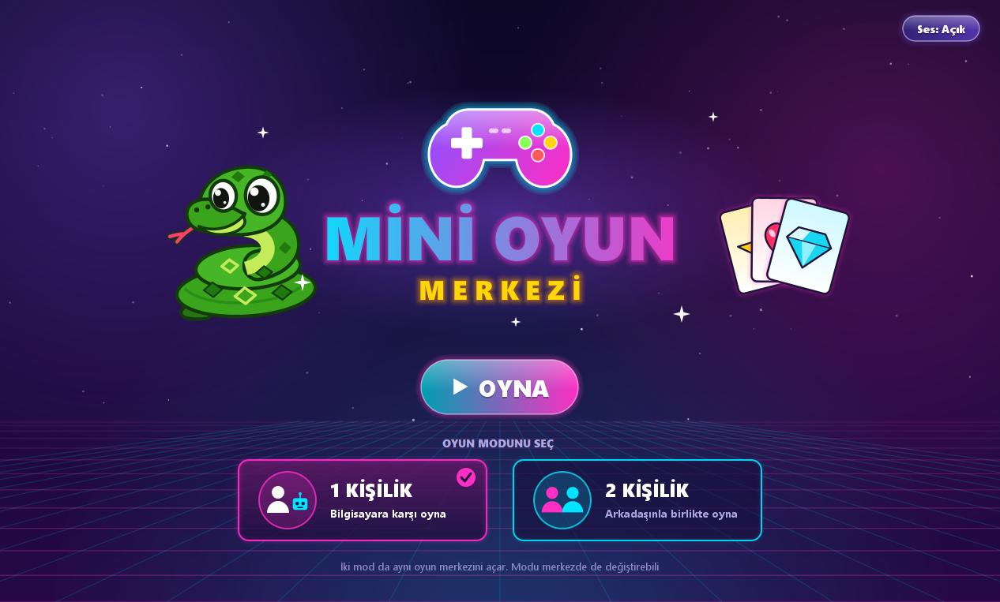

<sub><i>The launcher: glowing gamepad logo, the snake mascot, a fan of memory cards, the PLAY button and the two mode cards.</i></sub>

</div>

---

## 📌 Overview

**Mini Oyun Merkezi** is a desktop game hub written in **a single Java file** with **Swing** and **Java2D**. It opens on an animated, neon-lit launcher where the player picks a mode, **1 player (vs. the computer)** or **2 players (on the same keyboard)**, and then enters a hub of **ten game cards**.

Two of the games are fully playable, and both support **both modes**:

| | Game | 1 player | 2 players |
|:---:|---|---|---|
| 🐍 | **Snake (Yılan)** | One snake, endless food waves, combo multiplier, high score | **Green vs. blue snake** on one board: the first to crash loses |
| 🃏 | **Memory Cards (Hafıza Kartları)** | You vs. a **virtual computer player** | Player 1 vs. Player 2, taking turns |

The other **eight games are "coming soon" cards**, each with its own name, description and hand-drawn icon.

Everything you see and hear is **generated in code**: every icon, card face, mascot and background is drawn with Java2D shapes, and every sound effect is synthesized at runtime with the Java Sound API. The project ships **no image or audio files**.

---

## ✨ Features

- 🌌 **Neon game-site theme**: dark purple gradient, glowing light orbs, twinkling stars and a retro perspective grid
- 🕹️ **Animated launcher**: pulsing glow logo, floating snake mascot and memory cards, PLAY button with a hover glow
- 👥 **Mode selection** on the launcher *and* in the hub header; the chosen mode applies to every game
- 🗂️ **10-game hub**: 2 playable games and 8 locked "Yakında" (coming soon) cards with lock icons and hover effects
- 🐍 **Snake**: smooth interpolated movement, a cute cartoon head that looks at the nearest food, blinks and flicks its tongue, and a diamond-patterned body
- 🔁 **Automatic food waves**: when the board is cleared, a bigger wave spawns and the game speeds up
- 🃏 **Memory Cards**: 10 × 5 = **50 cards / 25 pairs** with 25 colorful drawn pictures, a 3D flip animation and **reshuffled positions every new game**
- 🤖 **Virtual opponent**: in 1-player memory the computer picks cards mostly at random, but sometimes remembers cards it has seen
- 🔊 **Synthesized sound effects**: "blip" button clicks, eat, wave, game over, card flip, match, mismatch and victory sounds, with a mute toggle on every screen
- 🎉 **Juice**: particles, confetti, floating score popups, screen shake and a red flash on crash
- ⏸️ **Auto-pause**: Snake pauses itself when the window loses focus

---

## 🧩 Architecture

### Screen flow (CardLayout)

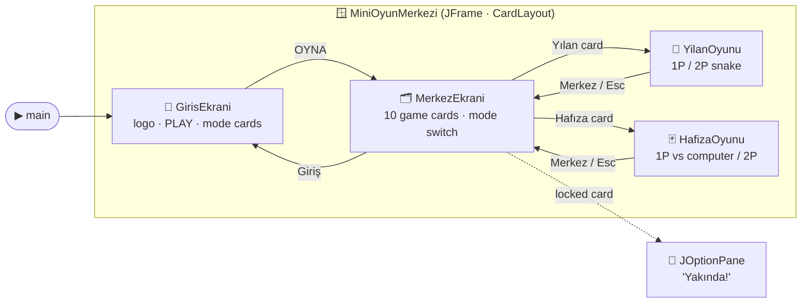

### Main building blocks

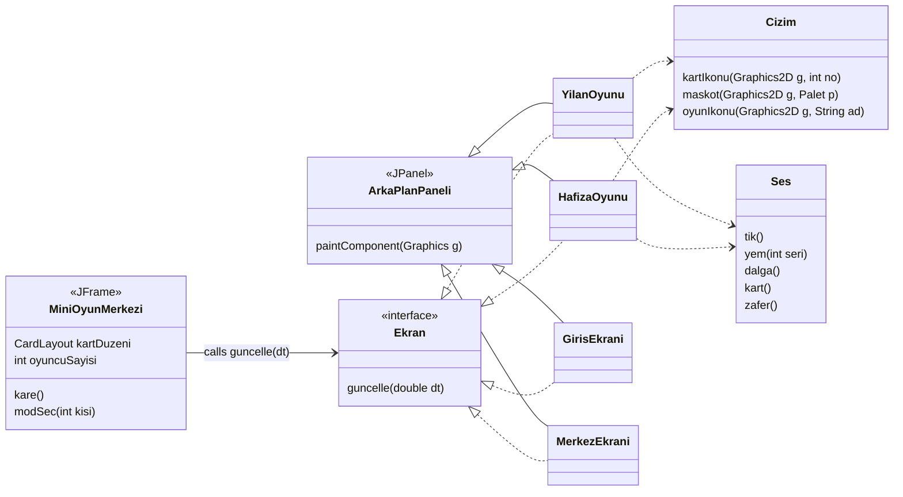

A single `javax.swing.Timer` (every 15 ms) drives the whole app: it measures the elapsed time and calls `guncelle(dt)` on the visible screen only. Each game advances its own logic and repaints its canvas.

### One memory turn against the computer

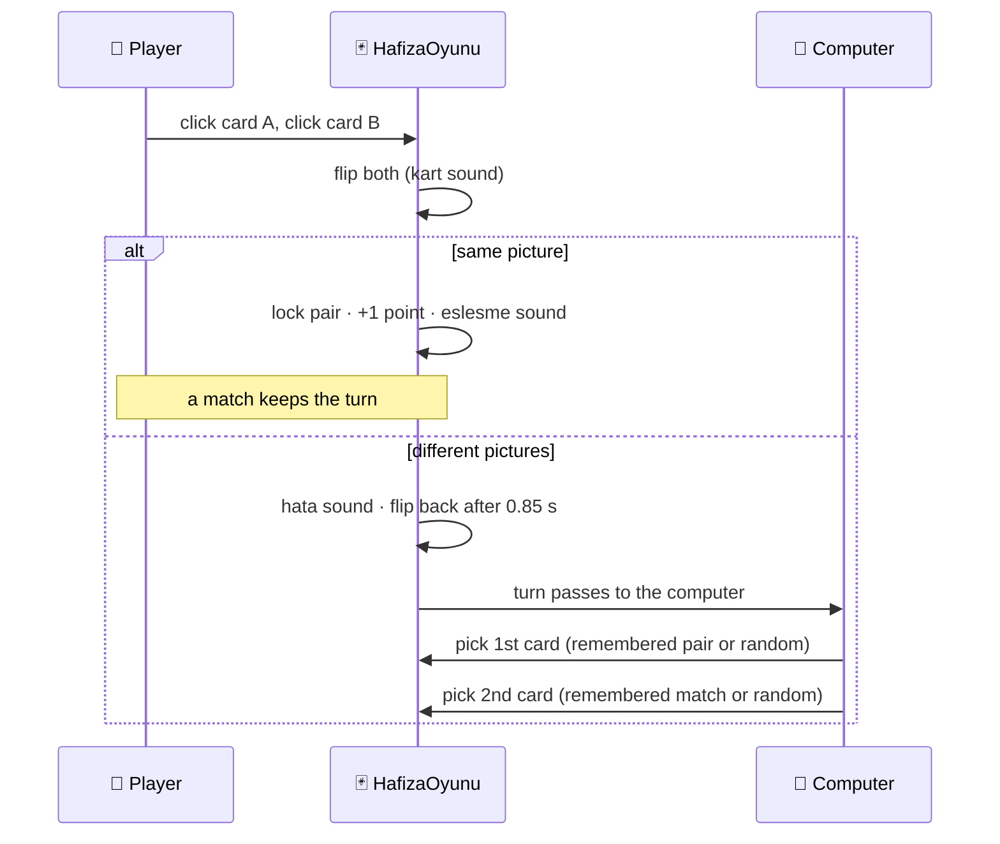

---

## 🐍 Snake Rules

| | 1 player | 2 players |
|---|---|---|
| **Board** | 22 × 16 | 26 × 16 |
| **Controls** | Arrow keys **or** W A S D | 🟢 Green: **W A S D** · 🔵 Blue: **arrow keys** |
| **Game over** | Hitting a wall or yourself | The **first snake to crash loses** · simultaneous crash (e.g. head-on) → higher score wins, equal → draw |

**Food types**

| Food | Points | Spawn chance |
|:---:|:---:|:---:|
| 🍎 Apple (Elma) | 10 | 60 % |
| 🍇 Grape (Üzüm) | 20 | 30 % |
| 💎 Diamond (Elmas) | 50 | 10 % |

- **Combo (Seri):** eating again within **5 seconds** raises the multiplier up to **×5**, so points = food value × multiplier.
- **Waves (Dalga):** a wave holds `2 + wave` foods (one more in 2-player mode, max 10). Clearing the board gives a **25 × wave** bonus and immediately spawns the next, bigger wave.
- **Speed:** each step starts at **135 ms** and gets **5 ms faster per wave**, down to **62 ms**.
- **Keys:** `Space` / `P` pause · `Enter` restart after game over · `Esc` back to the hub.

## 🃏 Memory Rules

- **50 cards, 25 pairs**, laid out 10 × 5. Every new game **reshuffles** the deck with `Collections.shuffle`.
- Flip two cards: a **match** stays face-up in the finder's color (pink / cyan) and **you play again**; a **mismatch** flips back and the turn passes.
- **1 player:** your opponent is the **computer**. It plays with short "thinking" delays, picks mostly at random and, with a **50 % chance** (`HATIRLAMA = 0.5`), uses cards it has already seen.
- **2 players:** Player 1 and Player 2 take turns with the mouse.
- The player with the most pairs wins. **YENİ OYUN** reshuffles and starts again.

<div align="center">
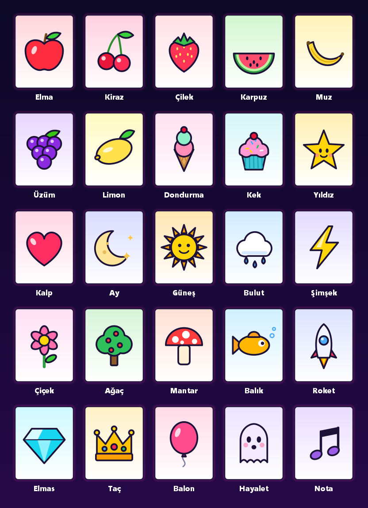
<br/><sub><i>All 25 card pictures, each drawn with Java2D shapes</i></sub>
</div>

---

## 🖼️ Gallery

### 🎬 In action

<table>
<tr>
<td width="50%" align="center">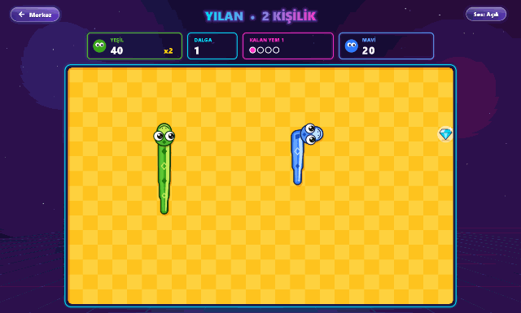<br/><sub><b>2-player Snake:</b> green vs. blue, chasing the same food waves</sub></td>
<td width="50%" align="center">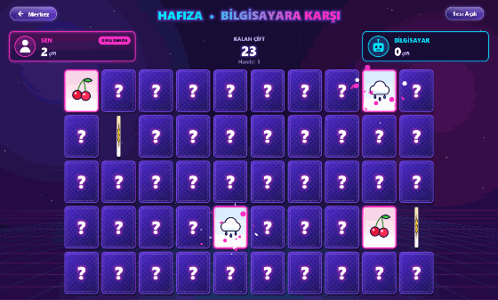<br/><sub><b>Memory vs. the computer:</b> flips, matches and turn changes</sub></td>
</tr>
</table>

### 🌌 Launcher & hub

<table>
<tr>
<td width="50%" align="center">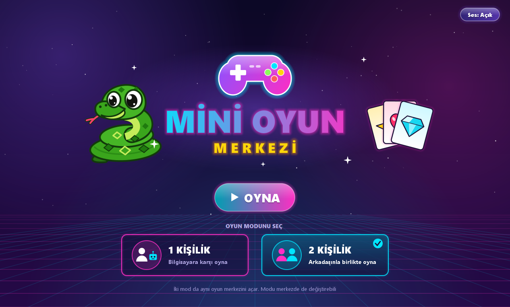<br/><sub><b>Launcher</b> with the 2-player mode selected</sub></td>
<td width="50%" align="center">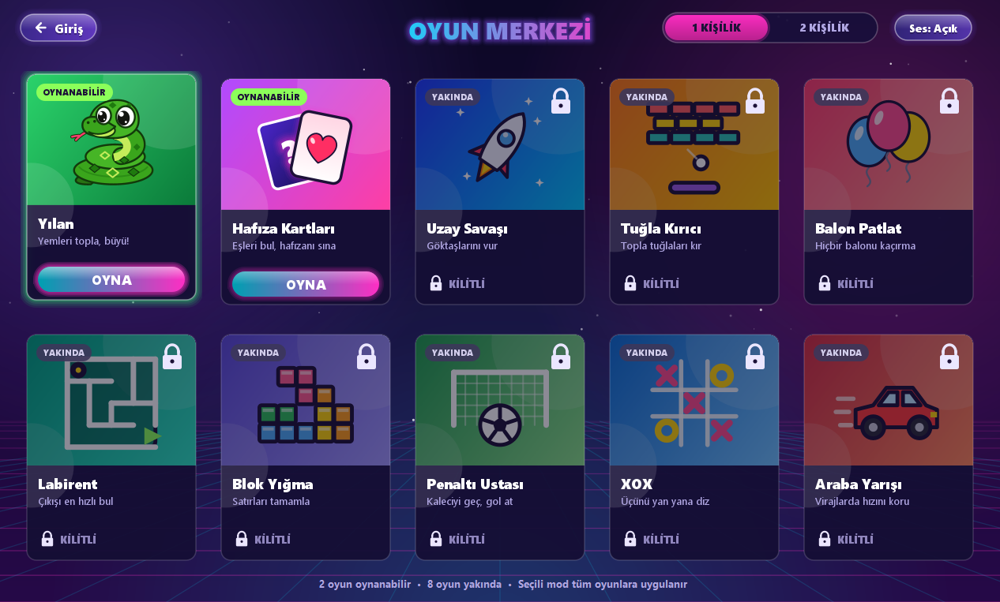<br/><sub><b>Game hub:</b> 2 playable games and 8 locked cards</sub></td>
</tr>
</table>

### 🐍 Snake

<table>
<tr>
<td width="33%" align="center">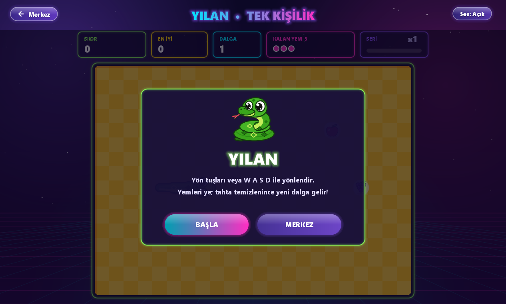<br/><sub><b>Start panel</b> with the mascot</sub></td>
<td width="33%" align="center">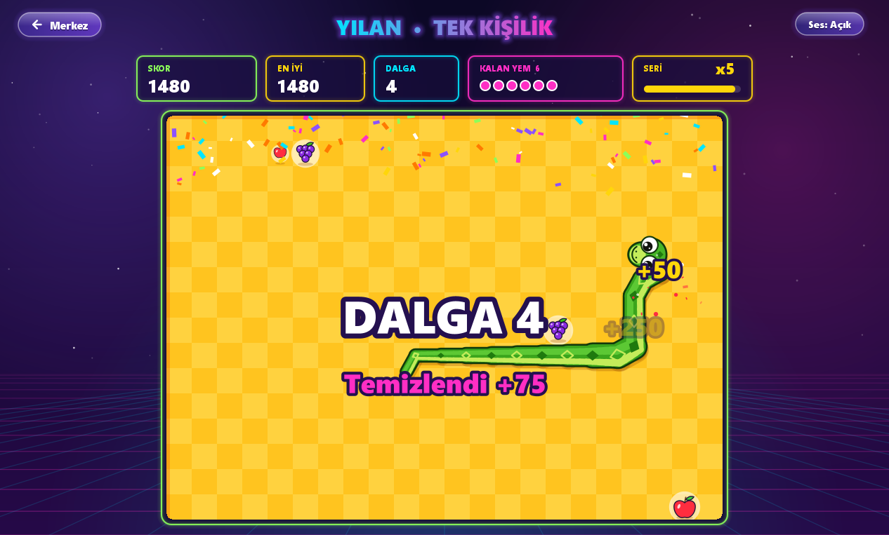<br/><sub><b>1 player:</b> wave cleared, ×5 combo</sub></td>
<td width="33%" align="center">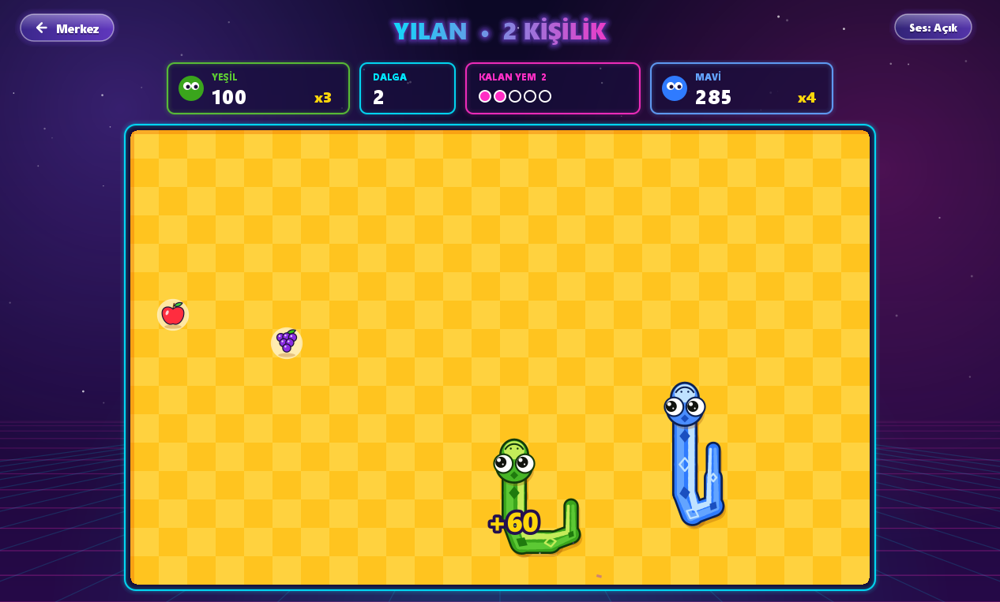<br/><sub><b>2 players:</b> live scores and combos</sub></td>
</tr>
</table>

<div align="center">
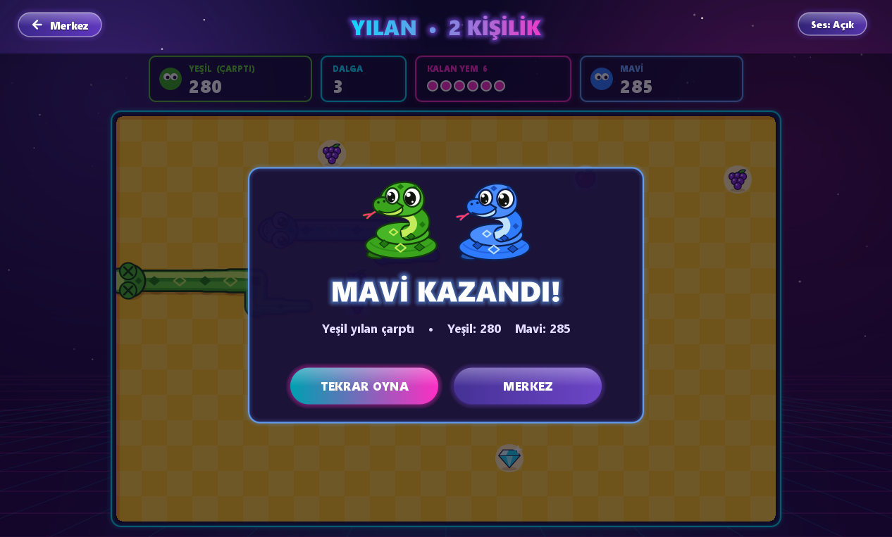<br/>
<sub><b>2-player result:</b> the crashed snake gets X eyes and the winner is announced</sub>
</div>

### 🃏 Memory Cards

<table>
<tr>
<td width="50%" align="center">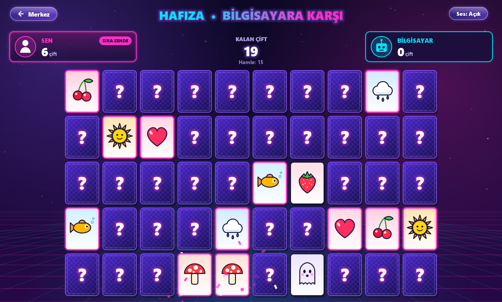<br/><sub><b>1 player vs. computer:</b> "SIRA SENDE" (your turn) badge and matched pairs glowing pink</sub></td>
<td width="50%" align="center">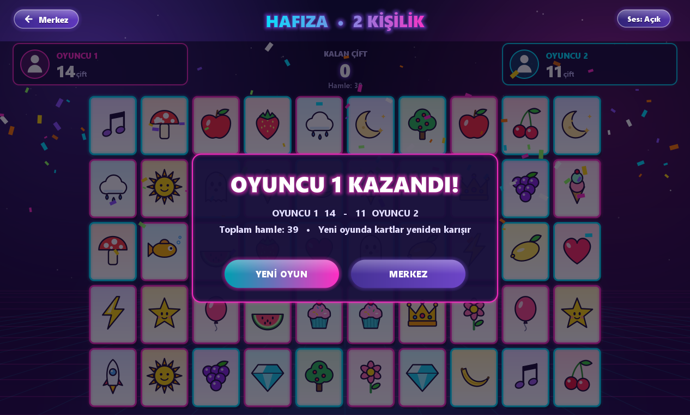<br/><sub><b>2-player result:</b> every pair glows in the color of the player who found it</sub></td>
</tr>
</table>

---

## 🔊 Sound Design

No audio files are used. `Ses` builds each effect from short notes and plays it with a `Clip` on a background thread, so the game never stutters:

| Sound | Where | Waveform |
|---|---|---|
| `tik` | every button click ("blip") | square + triangle |
| `secim` | switching 1P / 2P mode | rising triangle |
| `kilitli` | clicking a locked game | low falling square |
| `yem` | eating food, **pitch rises with the combo** | square + triangle |
| `dalga` | wave cleared (C–E–G–C arpeggio) | triangle |
| `bitti` | snake crash | falling sawtooth |
| `kart` / `eslesme` / `hata` | memory flip / match / mismatch | sine · triangle · square |
| `zafer` | memory game won | triangle arpeggio + chord |

---

## 💻 Code Highlights

**Both snakes move at the same time: compute every new head first, then check collisions**
```java
boolean carpti = h.x() < 0 || h.y() < 0 || h.x() >= sutun || h.y() >= satir;
for (int j = 0; j < n && !carpti; j++) {
    List<Nokta> govde = yilanlar.get(j).govde;
    // Yem yemeyen yılanın kuyruğu bu adımda boşalır, oraya girmek serbest.
    int son = yenen[j] != null ? govde.size() : govde.size() - 1;
    for (int k = 0; k < son; k++) {
        if (govde.get(k).equals(h)) {
            carpti = true;
            break;
        }
    }
    if (j != i && yeniBas[j].equals(h)) {
        carpti = true; // Kafa kafaya çarpışma
    }
}
```

**A fresh, fair deck every game: each picture twice, then shuffle**
```java
List<Integer> deste = new ArrayList<>();
for (int i = 0; i < KART_SAYISI / 2; i++) {
    deste.add(i);
    deste.add(i);
}
Collections.shuffle(deste, RASTGELE);
```

**The virtual player: sometimes it remembers, otherwise it guesses**
```java
private int ikinciKartiSec(int ilk) {
    if (RASTGELE.nextDouble() < HATIRLAMA) {
        for (Map.Entry<Integer, Integer> e : bilgisayarHafizasi.entrySet()) {
            int k = e.getKey();
            if (k != ilk && e.getValue() == yuz[ilk] && !eslesti[k] && !acik[k]) {
                return k;
            }
        }
    }
    List<Integer> kapali = kapaliKartlar(ilk);
    return kapali.get(RASTGELE.nextInt(kapali.size()));
}
```

**Sound synthesis: one sample of a square wave with an exponential fade-out**
```java
faz += 2 * Math.PI * f / ORAN;
double v = switch (n.dalga()) {
    case 'k' -> Math.sin(faz) >= 0 ? 1 : -1;               // square
    case 'u' -> 2 / Math.PI * Math.asin(Math.sin(faz));    // triangle
    case 't' -> 2 * ((faz / (2 * Math.PI)) % 1) - 1;       // sawtooth
    default -> Math.sin(faz);                              // sine
};
double zarf = n.ses() * Math.pow(0.001, p) * Math.min(1, i / (ORAN * 0.004));
```

---

## 📁 Project Structure

```
JOptionPane/                     # Eclipse project
├── src/
│   └── MiniOyunMerkezi.java     # the whole app: screens, games, drawings, sounds
├── images/                      # README screenshots and GIFs
├── .classpath / .project        # Eclipse project files
└── README.md
```

Inside `MiniOyunMerkezi.java` the code is split into clearly commented sections: **theme**, **helpers**, **sound (Ses)**, **shared UI components**, **1) launcher**, **2) hub**, **3) Snake**, **4) Memory** and **drawings (Cizim)**.

---

## 🚀 Getting Started

**Requirements:** JDK **17 or newer** (developed with JDK 25). No libraries to install.

### Eclipse
1. Import the folder as an existing project (*File → Import → Existing Projects into Workspace*).
2. Right-click `src/MiniOyunMerkezi.java` → **Run As → Java Application**.

### Command line
```bash
javac -encoding UTF-8 -d bin src/MiniOyunMerkezi.java
```
```bash
java -cp bin MiniOyunMerkezi
```

The window opens at **1280 × 800** (minimum 1040 × 700). Use the **Ses** button on any screen to mute.

---

<div align="center">

👩‍💻 Developed by **[Pınar Ayer](https://github.com/Ayer8315)**

</div>
